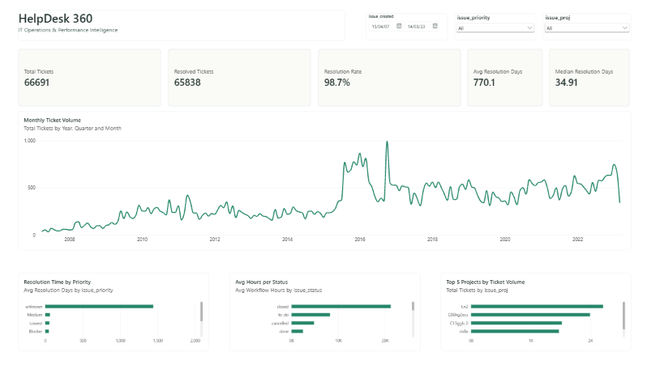

# HelpDesk360: Service Desk Power BI Dashboard

A one-page Power BI dashboard that analyzes IT service desk tickets: how many come in, how many get resolved, and how long resolution takes.



## Problem

A service desk needs to know its ticket volume and how quickly tickets are resolved. Resolution times are heavily skewed: a few tickets stay open for years, which inflates the average and hides what a typical ticket looks like.

## Solution

An interactive Power BI report that shows ticket volume and both the **mean** and the **median** resolution time side by side, so the typical case and the effect of outliers are both visible.

| Metric | Value (all tickets) |
| --- | --- |
| Total tickets | 66,691 |
| Resolved tickets | 65,838 |
| Resolution rate | 98.7% |
| Mean resolution time | 770.1 days |
| Median resolution time | 34.9 days |

The mean is about 22 times the median: most tickets are resolved in about a month, while a small number of very long-running tickets pull the average up. Reporting only the average would misrepresent typical performance.

**Report contents:** KPI cards, monthly ticket volume, resolution time by priority, average hours per workflow status, top 5 projects by ticket volume, and date, priority and project slicers.

**Tools:** Power BI, Power Query, DAX

## Key DAX measures

```DAX
HD Total Tickets = DISTINCTCOUNT ( issues[id] )

HD Resolved Tickets =
CALCULATE (
    [HD Total Tickets],
    FILTER ( issues, NOT ISBLANK ( issues[issue_resolution_date] ) )
)

HD Resolution Rate = DIVIDE ( [HD Resolved Tickets], [HD Total Tickets] )

HD Avg Resolution Days =
AVERAGEX (
    FILTER ( issues, NOT ISBLANK ( issues[issue_resolution_date] ) ),
    DIVIDE ( DATEDIFF ( issues[issue_created], issues[issue_resolution_date], SECOND ), 86400.0 )
)

HD Median Resolution Days =
MEDIANX (
    FILTER ( issues, NOT ISBLANK ( issues[issue_resolution_date] ) ),
    DATEDIFF ( issues[issue_created], issues[issue_resolution_date], SECOND ) / 86400.0
)
```

Both resolution measures use resolved tickets only and calendar days, so the mean and the median are directly comparable.

## Data

Public service desk ticket dataset from [Mendeley Data](https://data.mendeley.com/datasets/btm76zndnt/3). Credit for the data goes to its authors.

- Ticket creation dates span 2007 to 2023.
- The data is masked: projects, reporters and assignees are identifiers, not real names.

## Limitations

- Resolution time is calendar time, not working hours.
- Workflow hours are cumulative time per status from the source data; they describe the process, not staff performance.
- No SLA or satisfaction figures are reported, because the source data does not include them.

## Files

- `HelpDesk360.pbix`: the Power BI report (open with Power BI Desktop)
- `screenshots/dashboard.png`: the report page

## Author

Ruyuf Almajnooni · [LinkedIn](https://www.linkedin.com/in/reyouf-almajnooni)
